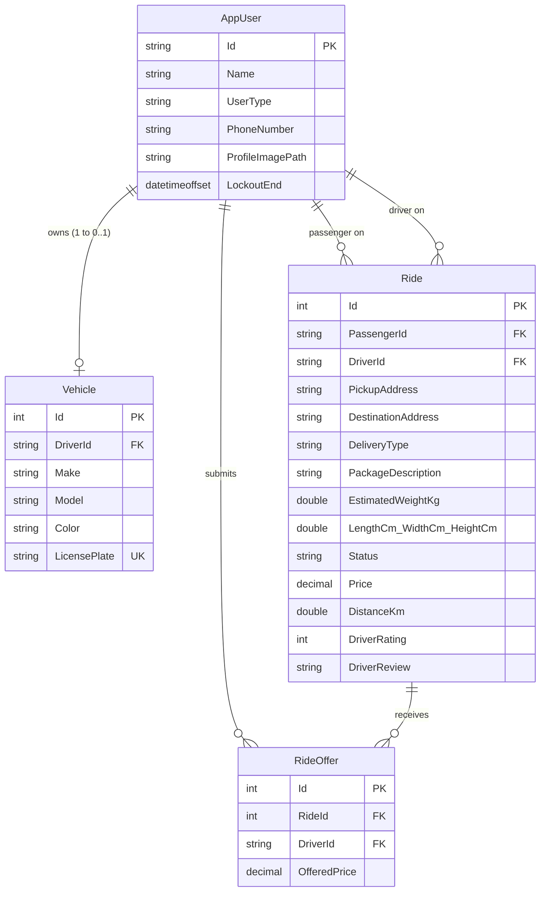

# 🚖 DeliveryApp

[](https://dotnet.microsoft.com/)
[](https://learn.microsoft.com/aspnet/core/mvc/overview)
[](https://learn.microsoft.com/ef/core/)
[](https://getbootstrap.com/)
[](https://leafletjs.com/)

An on-demand **ride-hailing and parcel delivery platform** built with ASP.NET Core 8 MVC and Entity Framework Core. DeliveryApp combines the ride-booking model of Uber with the flexible driver-bidding marketplace of inDrive, localized for the **Egyptian transportation market**.

---

## 📌 Table of Contents

- [Features](#-features)
- [Architecture & Tech Stack](#-architecture--tech-stack)
- [Pricing Model & Bidding Logic](#-pricing-model--bidding-logic)
- [Database Schema](#-database-schema)
- [Project Structure](#-project-structure)
- [Getting Started](#-getting-started)
- [License](#-license)

---

## 🚀 Features

### 🧑‍💼 Passenger

- **Dual Service Modes** — Request standard passenger rides or package deliveries (up to 20 kg).
- **Interactive Map Booking** — Pin pickup and destination on an OpenStreetMap interface powered by Leaflet.js, centered on Cairo.
- **Auto Reverse Geocoding** — Live address resolution via OpenStreetMap Nominatim API.
- **Real Road Distance** — Leaflet Routing Machine traces actual driving routes and calculates distance in kilometers.
- **Parcel Specs** — Specify package description, weight, and dimensions (length × width × height).
- **Driver Offer Marketplace** — Review real-time bids with driver names, profile photos, vehicle details, average star ratings, and review counts.
- **Direct Contact** — Driver phone number is revealed immediately once an offer is accepted.
- **5-Star Rating & Reviews** — Rate and review drivers after completed trips.

### 🚗 Driver

- **Profile & ID Upload** — Registration requires photo/ID upload and a verified Egyptian mobile number.
- **Vehicle Registration** — Mandatory car registration with unique license plate validation before accessing the job board.
- **Egyptian Auto Catalog** — Searchable dropdown with 45+ manufacturers popular in Egypt (Hyundai, Nissan, Chevrolet, BYD, Chery, MG, Geely, etc.) via Select2.
- **Live Job Board** — Browse available trip requests with base fares, distances, and package dimensions.
- **Dynamic Bidding** — Submit price offers within controlled boundaries (max 20% above base price).
- **Active Trip Lock** — Bidding and vehicle modifications are blocked while transporting an active passenger.
- **Reputation Dashboard** — Real-time average rating, total reviews, and full trip history.

### 🛡️ Admin Control Center

- **Auto-Provisioned Admin** — Admin role is automatically seeded on startup based on a configured email address.
- **Platform Analytics Dashboard** — Total users, total rides, and cumulative revenue from completed trips.
- **Driver Leaderboard** — Rankings sorted by highest average rating and completed trip count.
- **Recent Reviews Feed** — Live monitoring of the latest passenger reviews and comments.
- **User Management** — Audit trip stats per user, one-click 100-year ban/lockout, or account deletion.
- **Ride Oversight** — View all platform trips with status badges, participant metadata, and administrative cancellation.
- **Safety Guards** — Admins cannot ban/delete themselves; banning or deleting users with active trips is blocked.

### 🔒 Platform & Security

- **Egyptian Mobile Validation** — Regex validation for Egyptian prefixes (`010`, `011`, `012`, `015`, 11 digits) with database uniqueness.
- **Regional Geofencing** — Rejects ride requests where pickup and destination are in different cities/regions.
- **Instant Ban Eviction Middleware** — Custom ASP.NET Core middleware detects locked-out users and immediately signs them out, terminating active sessions.
- **Concurrency Safeguards** — Prevents driver double-booking and passenger multi-requesting via server-side checks.
- **Storage Hygiene** — Profile pictures stored with GUID filenames; replacing an image auto-deletes the old file.

---

## 🛠️ Architecture & Tech Stack

| Layer | Technology |
| :--- | :--- |
| **Backend** | ASP.NET Core 8.0 MVC (C# 12) |
| **Authentication** | ASP.NET Core Identity with custom `AppUser` + Role-Based Access |
| **Database & ORM** | Entity Framework Core 8.0 — SQL Server LocalDB |
| **Mapping & GIS** | Leaflet.js 1.9.4 + OpenStreetMap tiles |
| **Routing** | Leaflet Routing Machine (road distance calculation) |
| **Geocoding** | OpenStreetMap Nominatim Reverse Geocoding API |
| **Frontend** | Razor Views, Bootstrap 5.1, Select2 4.1.0, jQuery |
| **Validation** | DataAnnotations + jQuery Unobtrusive Validation |

---

## 💰 Pricing Model & Bidding Logic

### Base Price Calculation

**Passenger Rides:**

```
Price = $5.00 + (Distance in km × $1.50)
```

**Package Deliveries:**

```
Price = $5.00 + (Weight kg × $2.00) + (Length × Width × Height × 0.001) + (Distance in km × $1.00)
```

### Anti-Price-Gouging Bidding

Drivers can bid **at or above** the base price, but the system enforces a strict **20% ceiling**:

```
Max Allowed Bid = Round(BasePrice × 1.20, 2)
```

Bids outside this range are rejected by server-side validation. When a passenger accepts an offer, the winning bid becomes the official trip price and all other offers are purged.

---

## 🗄️ Database Schema



**Key constraints:**
- `RideOffer` → `Ride` and `RideOffer` → `Driver`: Foreign keys with `DeleteBehavior.Restrict` (avoids cascade cycles).
- `Vehicle.LicensePlate`: Unique database index enforced.
- Ride statuses: `Requested` → `Driver Assigned` → `Completed` | `Cancelled`.

---

## 📂 Project Structure

```
DeliveryApp/
├── DeliveryApp.sln
└── DeliveryApp/
    ├── Areas/
    │   └── Identity/                # Scaffolded Identity UI (Register, Login, Manage)
    ├── Controllers/
    │   ├── AdminController.cs       # Analytics, moderation, ban/delete
    │   ├── HomeController.cs        # Role-based landing page
    │   ├── RideController.cs        # Ride requests, bidding, completion, ratings
    │   └── VehicleController.cs     # Vehicle registration and editing
    ├── Data/
    │   └── ApplicationDbContext.cs  # EF Core DbContext with FK constraints
    ├── Migrations/                  # EF Core schema migrations
    ├── Models/
    │   ├── AppUser.cs               # IdentityUser extension (Name, UserType, etc.)
    │   ├── Vehicle.cs               # Make, Model, Color, LicensePlate
    │   ├── Ride.cs                  # Trip record with pricing, ratings, dimensions
    │   ├── RideOffer.cs             # Driver bid linking Ride ↔ Driver ↔ Price
    │   ├── AdminUserViewModel.cs    # Admin dashboard aggregation
    │   ├── AvailableDriverViewModel.cs  # Offer review with driver stats
    │   └── ErrorViewModel.cs
    ├── Views/
    │   ├── Admin/                   # Dashboard, user list, ride monitor
    │   ├── Home/                    # Landing page
    │   ├── Ride/                    # Request form, offer review, ratings
    │   ├── Shared/                  # Layout, navbar, login partial
    │   └── Vehicle/                 # Registration and edit forms
    ├── wwwroot/
    │   ├── css/                     # Custom stylesheets
    │   ├── images/                  # Uploaded profile pictures & ID docs
    │   ├── js/                      # Custom JavaScript
    │   └── lib/                     # Client-side libraries (Bootstrap, jQuery, etc.)
    ├── appsettings.json             # Connection string & admin email config
    └── Program.cs                   # DI, Identity config, seeding, ban middleware
```

---

## 🏁 Getting Started

### Prerequisites

- [.NET 8.0 SDK](https://dotnet.microsoft.com/download/dotnet/8.0)
- [SQL Server](https://www.microsoft.com/sql-server/) or SQL Server LocalDB (included with Visual Studio)

### Configuration

Open `DeliveryApp/appsettings.json` and configure:

```json
{
  "ConnectionStrings": {
    "DefaultConnection": "Server=(localdb)\\mssqllocaldb;Database=DeliveryAppDb;Trusted_Connection=True;MultipleActiveResultSets=true"
  },
  "AppSettings": {
    "AdminEmail": "your-admin@example.com"
  }
}
```

> **Note:** The email specified under `AppSettings:AdminEmail` will automatically be granted the **Admin** role upon registration.

### Database Setup

Apply Entity Framework Core migrations to create the database:

```bash
dotnet ef database update
```

Or in the Visual Studio **Package Manager Console**:

```powershell
Update-Database
```

### Running the Application

```bash
dotnet run --project DeliveryApp/DeliveryApp.csproj
```

Then navigate to `https://localhost:7082` (or the port shown in console output).

---

## 📄 License

This project is open-source and available under the [MIT License](LICENSE).
